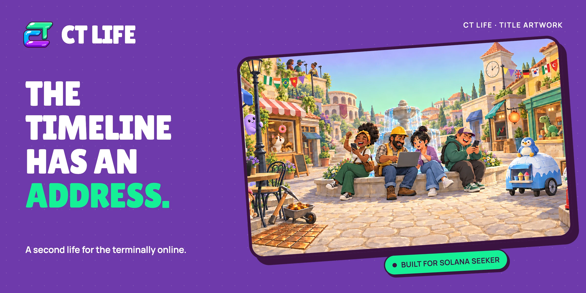

  

<h1 align="center">The timeline has an address.</h1>

  CT Life is a 3D social life-sim set in Crypto Twitter. Built for the Solana Seeker.

  <a href="docs/spec/build-spec.md"><strong>Explore the game</strong></a>
  &nbsp;·&nbsp;
  <a href="docs/HANDOFF-FRONTEND.md"><strong>Build &amp; contribute</strong></a>
  &nbsp;·&nbsp;
  <a href="https://github.com/devIykee/ct-life-backend"><strong>Backend</strong></a>

## Your comeback arc starts here

  

Insider Baby or Exit Liquidity Baby? Roll your origin, pick your tribe, and choose the dream you’re chasing. Starting in your parents’ basement is part of the lore.

## Meet at Terminal Café

  

Coffee, computers, familiar CT archetypes. Walk in, grab a seat, and take a break from the charts. Every timeline needs a regular spot.

## Go outside. Stay online.

  

Wander Timeline Square, meet the local Doomposter, and open your in-game phone for jobs, markets and city life. Work a shift. Earn game Cash. Start your next chapter.

*Game Cash belongs to the simulation and cannot be withdrawn.*

## Build with us

**In development.** These are title artwork and real Seeker development captures. Multiplayer, voice, payments and expanded character customization are still being integrated and tested.

1. Start from `dev` and open `client/` in **Unity 6000.3.25f1** with **Android Build Support**, SDK, NDK and OpenJDK.
2. Open `Assets/Scenes/Bootstrap.unity`. Follow the [frontend handoff](docs/HANDOFF-FRONTEND.md) for backend configuration, tests and Seeker builds.

This is the Unity frontend, art and audio repository. **devIykee** maintains the [backend and Solana programs](https://github.com/devIykee/ct-life-backend) separately. Open frontend pull requests against `dev`.

[Contributor brief](docs/AGENTS-BRIEF.md) · [Art credits](art/LICENSES.md) · [Audio credits](audio/LICENSES.md) · [Image sources](docs/media/readme/SOURCES.md)
