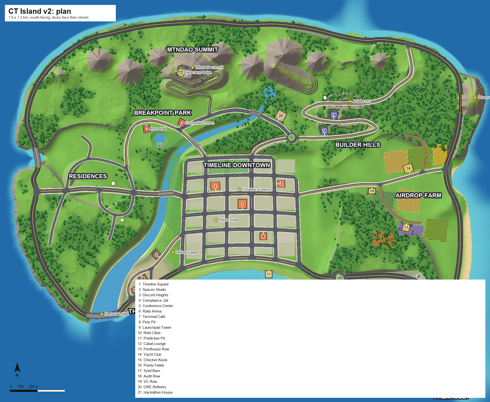

# CT Island v2: plan (World lane, 2026-10-17)

The plan image and every number below come from one generator, `tools/world/islandgen/` (`layout.py` is the authored
plan; run `islandgen.py`). The Unity builder reads its output, so the map, the terrain and the roads cannot drift
apart. Interface with the Feel lane: `docs/design/world-v2-contract-20261017.md`.

## Concept

- A south-facing island, about 1.7 x 1.2 km, with no grid outside downtown. A mountain range runs along the north coast. The
  MtnDAO summit stands 175 m above the sea, with snow, rock faces and forest below the tree line. Foothills and the
  terraced Builder Hills step down to a city on the slope above a crescent bay.
- A river rises at a foothill spring, runs past Breakpoint Park and down the west side of downtown, and widens into the Trenches
  harbour. It has three bridges, plus the harbour bridge and the fjord bridge on the Coast Highway.
- The coastline varies: west cliffs with a fjord inlet, a north coast of cliffs and coves (Gm Cove), the Observatory
  peninsula with a tunnel through it, the farm's east beach and cove, the Dubai Marina basin behind Marina Point, the
  south-east lighthouse peninsula, and the Palm Islet reached by a causeway.
- Districts sit 300 to 700 m apart and venues 50 to 185 m apart along real streets. Every venue faces its own street, so
  its yaw follows that street.

## Scale and coordinates

- Island metres: +x east, +z north, +y up. The origin is the centre of the Timeline Square plaza at **y = 0**. **Sea level is
  y = -6**, so the flight ceiling is y = 214 (220 m above the sea).
- Lanes are 3.3 m and the island drives on the right. Downtown streets have 2.4 m parking lanes and 3 m sidewalks; avenues
  have 4 m sidewalks.
- Roads total 13.3 km: Coast Highway 3.7 km (2+2 lanes, 90 km/h), avenues 3.5 km, downtown streets 3.2 km, the mountain road
  0.6 km, suburban streets 0.9 km, dirt and service roads 0.8 km, bridges 0.33 km and the tunnel 0.21 km. There are 64
  junctions: 24 signals, 30 stops, 2 roundabouts and 4 merges.

## Districts

| District | Character | Height and density | Venues |
|---|---|---|---|
| Timeline Downtown | The only grid. Its streets fan out towards the bay and bow gently. Ocean Drive (a palm boulevard) runs along the bay. The plaza block, Genesis Park, and giant CT billboards and screens are here. | 8 to 30 storey towers in the core, shops with awnings at street level | Timeline Square, Spaces Studio, Discord Heights, Compliance Jail |
| Beachfront Boardwalk | A crescent beach with a boardwalk and seawall below Ocean Drive. It has kiosks, lifeguard towers, a fairground and an arcade pier. | Low; open sky | Prediction Pit (pier) |
| The Trenches | Harbour docks on the east bank of the estuary: warehouses, cranes, containers, graffiti, the Helius depot | 1 to 4 storeys, gritty and dense | Terminal Café, Perp Pit, Launchpad Tower, Rekt Clinic |
| Dubai Marina | A glass-tower strip between the Coast Highway and the basin quay, with yachts in the basin and the yacht club on Yacht Quay | The tallest buildings, 20 to 40 storeys | Cabal Lounge, Penthouse Row, Yacht Club |
| Builder Hills | A tech campus and hacker houses on 9 m terraces, Builder HQ (Superteam) at the top, and Hills Drive winding up through them | 2 to 6 storeys | Audit Row, VC Row |
| Breakpoint Park | Lawns and a pond between the river and Breakpoint Way. The convention centre stands on the north side and the arena hall (Colosseum) on the south side. | Big single halls | Conference Center, Ratio Arena |
| Airdrop Farm | Rolling fields in eight crop patches, barns, silos and windmills, served by dirt tracks | Low and sparse | Checker Kiosk (farm gate), Points Fields, Sybil Barn |
| Residences | Curving suburban lanes, a crescent and cul-de-sacs on the west plateau above the cliffs | 1 to 2 storey houses with yards | (private home exteriors) |
| Mountain | The foothill quarry, the switchbacks, the basecamp lodge and forest | Sparse | ORE Refinery (quarry), Hackathon House (MtnDAO basecamp lodge) |

## Roads

- **Coast Highway**: 2+2 lanes around the island, with gentle curves. It crosses the harbour on a bridge, crosses the fjord
  inlet on another, tunnels through the Observatory peninsula, and runs along a shelf between the mountains and the north
  cliffs. In town it becomes **Ocean Drive**, an avenue along the bay.
- **Avenues**: Genesis Avenue (east-west through downtown, over the river to the Residences), Timeline Avenue (north-south,
  becoming Hills Drive), Farm Road, Harbour Road, Breakpoint Way.
- **Downtown grid** of 2-lane streets with parallel parking. Liquidity Street runs one way east and Hodl Street one way
  west. Superblocks make room for the plaza and Genesis Park.
- **Summit Road**: three contour-following switchback legs on the summit's south face at a 9.8 % grade, rising to the
  basecamp lodge at y = 78. The lodge looks out over the city, with the summit 90 m higher behind it. Guard rails run on
  the drop side.
- **Other roads**: winding suburban lanes, farm dirt tracks, Quay Street, the Marina Promenade, Yacht Quay and the Palm Causeway.
- **Junctions**: roundabouts at Builder Hills (B1) and the marina gate (HM1), and signals on the avenues.
- **Parking and helipads**: street parking bays on the downtown streets, plus lots at the beach, marina, farm and lodge.
  Helipads are at the lodge, the marina and Breakpoint Park.

## Venues (computed placement; yaw is clockwise from north, as Unity's +Y rotation)

| Venue | District | Faces | Root (x, z) | y | Yaw |
|---|---|---|---|---|---|
| Timeline Square | timeline | the plaza block, door to Gm Street | (0, 0) | 0.0 | 0 |
| Spaces Studio | timeline | Genesis Avenue | (-98, 64) | 0.4 | 357 |
| Discord Heights | timeline | Validator Street | (144, 73) | 0.6 | 89 |
| Compliance Jail | timeline | Liquidity Street | (76, -120) | -0.5 | 181 |
| Conference Center | breakpoint | Breakpoint Way | (-218, 295) | 16.7 | 30 |
| Ratio Arena | breakpoint | Breakpoint Way | (-347, 270) | 17.0 | 172 |
| Terminal Café | trenches | Harbour Road | (-312, -185) | -1.7 | 311 |
| Perp Pit | trenches | Harbour Road | (-359, -275) | -4.0 | 149 |
| Launchpad Tower | trenches | Quay Street | (-311, -292) | -4.1 | 105 |
| Rekt Clinic | trenches | Coast Highway (Dock St) | (-392, -312) | -1.1 | 331 |
| Prediction Pit | boardwalk | the boardwalk (pier) | (96, -258) | -3.2 | 180 |
| Cabal Lounge | dubai_marina | Marina Promenade | (470, -292) | -1.1 | 1 |
| Penthouse Row | dubai_marina | Marina Promenade | (559, -294) | -3.5 | 356 |
| Yacht Club | dubai_marina | Yacht Quay | (373, -394) | 0.7 | 279 |
| Checker Kiosk | airdrop_farm | Farm Road (gate) | (470, 46) | 10.3 | 180 |
| Points Fields | airdrop_farm | Farm Road | (603, 128) | 2.8 | 344 |
| Sybil Barn | airdrop_farm | Sybil Lane | (594, -89) | 10.4 | 194 |
| Audit Row | builder_hills | Hills Drive, terrace 1 | (298, 267) | 17.2 | 358 |
| VC Row | builder_hills | Hills Drive, terrace 2 | (333, 324) | 26.3 | 4 |
| ORE Refinery | mountain | Foothill Road (quarry) | (139, 320) | 21.2 | 28 |
| Hackathon House | mountain | Summit Road (MtnDAO lodge) | (-221, 479) | 78.5 | 24 |

Homes stay private visits; their exteriors go to the Residences (parents' basement, studio), Builder Hills (hacker
house) and the marina (penthouse tower, Marina Point villa).

## Landmarks you can see from afar

The MtnDAO summit and basecamp lodge; the Colosseum-style arena hall; the Breakpoint convention centre; Builder HQ
(Superteam purple and yellow); the observatory dome on the Observatory peninsula (Jupiter's banded planet); the Seeker
phone shop downtown; the Helius depot with its orange "faster" sign; the lighthouse; the harbour bridge; Palm Islet;
the Timeline screens around the plaza.

## The 80 community nods

Each nod is one of our own original props, following the rules in `docs/research/community-eggs-2026-10.md`: no
logos, and only words we invented.

- **Downtown**:
  - BONK striped stall
  - Popcat bakery window
  - Claynosaurz and Star Atlas toyshop
  - GIGA gym poster
  - pixel-monkey mural (SMB)
  - DeGods striped shop
  - BAN banana gallery
  - USELESS coin doorstop
  - Sanctum cloud weathervane
  - Superteam India chai stall, UK post box and Vietnam scooter
  - Perennials flower stall
  - ANSEM bull in front of the bank
  - Marinade chef-hat bull over the steakhouse
  - Seeker phone shop with the Sagamonkes pixel monkey
  - Superteam bunting over the plaza streets
  - three slanted roof tiles (Solana)
  - Backpack, ZCAT and Turkey tea glass on café terraces
- **Genesis Park**:
  - Moo Deng hippo in the fountain
  - Phantom-style ghost behind a lamp-post
  - Pippin chalk doodle
  - Wormhole ring arch
- **Beach boardwalk**:
  - PENGU igloo shaved-ice cart
  - Meteora surf shack
  - Kamino beach hut
  - Bonk.fun mallet game
  - Brazil football and drum
  - Solanons bench
  - Collector Crypt capsule machine and RadiantsDAO sun mosaic at the arcade pier
- **The Trenches**:
  - pump.fun capsule machine
  - Mad Lads poster
  - MEW on sacks
  - GMGN frog sticker
  - TROLL mask
  - Orca fish stall
  - DeadKing barrel
  - Frens Factory shutter
  - Pythenians statue by the art wall
  - Metaplex coin press
  - Superteam Nigeria danfo bus (the Lagos corner)
  - Helius depot
  - Terminal Café nods: WIF and catwifhat, JUPCAT on the sill, Fartcoin, Axiom skylight, Jito and Jito Cabal tip jar
- **Dubai Marina**: Cets deck chair on the quay wall.
- **Builder Hills**:
  - Builder HQ (Superteam)
  - hacker houses with glowing laptops
  - MagicBlock hat lantern
  - SKR door plate
  - Helium rooftop antenna
  - FFF fox and GOAT weathervanes
- **Breakpoint Park**:
  - arena hall with "ENTER" (Colosseum)
  - "Checkpoint" banner and badges (Breakpoint)
  - Phantom-style ghost statue
  - PNUT squirrel
  - MonkeDAO picnic table
  - Moonbirds nest box
  - Sensei bear zen corner
  - Korea food cart
  - Solflare sunburst over the stage door
- **Farm and foothills**:
  - ORE pickaxe and copper 5x5 tiles at the quarry
  - Pyth chalkboard and Bags sack at the farm stall
  - MetaDAO arrow sign on Farm Road
  - Grass tuft and router in the Residences
  - Galactic Geckos garage
  - NEET window
- **Mountain**:
  - MtnDAO sand mountain and blue sun on the lodge wall, with a big banner at the summit
  - Mind Folk woodpile
- **Elsewhere**:
  - Jupiter observatory
  - IslandDAO palm on the islet
  - x402 robot at the causeway toll bar
  - Solana gradient in the golden-hour sky

## Build pipeline

1. `tools/world/islandgen/islandgen.py` writes `out/`:
   - `height.r16`: 1025 x 1025 samples, 2 m apart
   - `control.png` and `macro.png`: ground maps
   - `holes.png`: tunnel portals
   - `roads.json`: nodes, dense trimmed segment samples, lanes, lane links, junction polygons
   - `plan.json`: venues, homes, landmarks, districts, river, fields
2. `CTLife.EditorTools.IslandV2.IslandV2Builder` (Unity) builds the following from `out/`:
   - terrain chunk meshes with LODs and colliders
   - road meshes (ribbons, junctions, markings, kerbs, bridges, the tunnel, guard rails)
   - water
   - `RoadNetwork.asset`
   - the streamed cell prefabs and the island prefab
   - the pedestrian NavMesh
